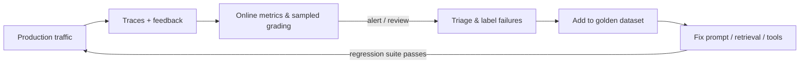

# Drift Detection & Failure Tracking

::: details Q: What can drift in an LLM system after launch?
- **Input drift**: users ask new kinds of questions, new products launch, a new customer segment onboards, language mix changes.
- **Knowledge drift**: the documents behind RAG change, go stale, or get deleted, while the index lags.
- **Model drift**: the provider updates or deprecates a model version; pinned versions still retire on a schedule.
- **Upstream drift**: a tool's API changes its response shape, a data source adds a field, a schema migration lands.

The output looks fluent the whole time. Quality drops quietly, which is why it needs measuring, not watching.
:::

::: details Q: What should you log for every request?
The full trace: inputs, assembled prompt (or its version and retrieved chunk IDs), model and version, tool calls with arguments and results, output, token counts, latency, and cost. Plus any user signal: thumbs, edits to the draft, escalation to a human, re-asks. Respect the customer's data rules: redact PII, honor retention limits, and agree up front on what may leave their environment.
:::

::: details Q: How do you detect a quality drop without labels?
Combine cheap signals:
- **Proxy metrics**: thumbs-down rate, human-escalation rate, re-ask rate, "I don't know" rate, output length, tool error rate.
- **Online grading**: run an LLM judge with a fixed rubric on a sample of production traffic daily (faithfulness, policy compliance).
- **Input distribution**: cluster or embed incoming queries and track the share falling into new or low-performing clusters.
- **Scheduled re-runs** of the golden set against production config, to catch model and knowledge drift even when traffic looks normal.

Alert on sustained changes against a baseline, not single spikes.
:::

::: details Q: How do you turn failures into improvements?
Make a failure inbox: sampled bad traces, thumbs-down, and escalations go to a weekly review with the customer's domain expert. Label each one with a root cause category: retrieval miss, content gap, wrong tool, instruction ignored, hallucination, out of scope. Count by category to decide what to fix next. Every fixed failure becomes a new case in the [golden dataset](./eval-datasets), so it cannot come back unnoticed.
:::

::: details Q: How do you handle a provider model upgrade safely?
Pin the model version in config. When a new version appears or the old one is scheduled for retirement, run the full eval suite on both, compare per-case diffs, check cost and latency, then roll out gradually (shadow traffic or a percentage split) with the proxy metrics above watched closely. Keep the rollback path to the previous version until the retirement date.
:::

::: details Q: Who owns this once the FDE leaves?
Decide before launch. The customer's team needs the dashboards, the failure review habit, the eval suite, and a runbook for "quality dropped" and "provider outage". An FDE engagement that ships a great demo but no monitoring hands the customer a system that degrades without anyone noticing.
:::

## Related

- [Golden datasets & regression suites](./eval-datasets)
- [Observability tools](../tools/observability)
- [Production incident (behavioral)](../behavioral/production-incident)
