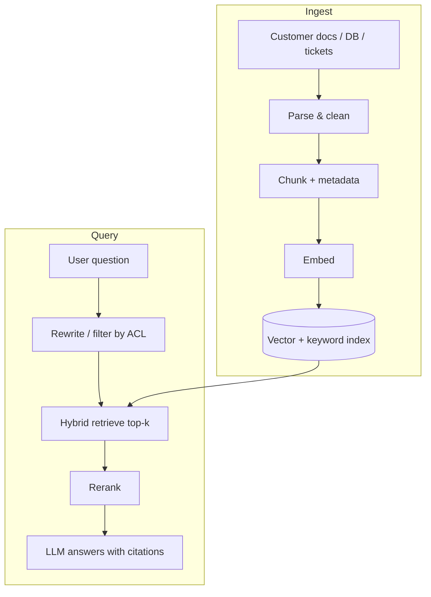

# RAG Pipelines

::: details Q: When should you use RAG instead of long context or fine-tuning?
RAG fits when the knowledge is large, changes often, needs citations, or has per-user permissions. Long context is simpler when the corpus is small (a few hundred pages) and the same for every user. Fine-tuning changes *behavior and format*, not knowledge; it is a poor way to teach facts that change next week. Many production systems combine them: RAG for facts, prompt or light fine-tune for style.
:::

::: details Q: What are the ingestion decisions that matter most?
- **Parsing**: PDFs with tables, scanned pages, and slide decks are where quality dies. Inspect parsed output by eye before tuning anything else.
- **Chunking**: split on structure (headings, sections) over fixed sizes; keep chunks small enough to be specific and large enough to stand alone. Overlap helps a little; adding the document title and section path to each chunk helps more.
- **Metadata**: source, date, owner, and **access control** on every chunk. Retrofitting permissions later is painful.
- **Freshness**: an incremental sync (CDC or change timestamps) and deletes. A deleted policy that is still retrievable is a liability.
:::

::: details Q: Why use hybrid retrieval and a reranker?
Embeddings match meaning but miss exact tokens: part numbers, error codes, names, acronyms. Keyword search (BM25) catches those and misses paraphrases. Hybrid retrieval runs both and merges results (for example with reciprocal rank fusion). A reranker (a cross-encoder or an LLM) then scores the top 50 to 100 candidates against the question and keeps the best few. Reranking costs latency but usually gives the biggest quality jump per hour of work.
:::

::: details Q: The RAG bot gives a wrong answer. How do you debug it?
Split the pipeline and find which stage failed:
1. **Was the answer in the corpus at all?** If not, it is a content gap, not a model bug.
2. **Was it parsed and chunked correctly?** Look at the actual chunk text.
3. **Was it retrieved?** Check whether the right chunk was in top-k. If not, it is a retrieval problem: try hybrid search, query rewriting, metadata filters, or better chunk boundaries.
4. **Was it retrieved but ignored or misread?** Generation problem: too many distractor chunks, unclear instructions, or conflicting sources.

Measure retrieval (recall@k against labeled question to chunk pairs) separately from answer quality, or you will tune the prompt to fix a retrieval bug.
:::

::: details Q: How do you handle permissions and tenancy?
Filter at retrieval time, using the caller's identity, before anything reaches the model. Never rely on the prompt to "not mention" documents the user cannot see. In multi-tenant setups, partition indexes or enforce tenant filters in the query layer, and include an eval case where a user asks for another tenant's data.
:::

::: details Q: What are the main cost and quality trade-offs?
| Choice | Gains | Costs |
|---|---|---|
| Larger top-k | recall | tokens, distraction |
| Reranker | precision | 100 to 500 ms latency, extra cost |
| Query rewriting | recall on vague questions | an extra LLM call |
| Bigger embedding model | quality on niche domains | re-embedding the whole corpus |
| Agentic retrieval (model searches iteratively) | hard multi-hop questions | latency, unpredictability |

Start with simple hybrid + rerank, measure, then add complexity where the eval set shows misses.
:::

## Related

- [Prompt & context engineering](./prompt-context-engineering)
- [Golden datasets & regression suites](./eval-datasets)
- [Change data capture](../technical/concepts/change-data-capture)
