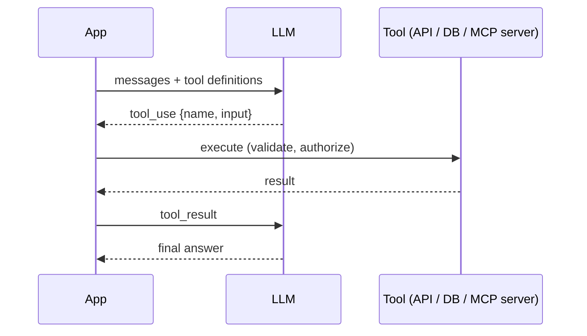

# Tool Use & MCP Servers

::: details Q: How does tool use actually work?
You send the model a list of tools, each with a name, description, and JSON Schema for its input. The model does not execute anything: it returns a structured request to call a tool. **Your code** validates the input, checks permissions, runs it, and sends the result back. The loop repeats until the model answers without a tool call. That boundary is where an FDE puts auth, validation, logging, rate limits, and human approval.
:::

::: details Q: What makes a tool easy for a model to use correctly?
Design tools for the model the way you would design an API for a new teammate:
- **Clear names and descriptions** that say when to use it and when not to. The description is a prompt.
- **Few, task-shaped tools** over many thin wrappers. `search_customer_orders(email, status)` beats exposing raw `GET /orders`, `GET /customers`, `GET /order_items`.
- **Constrained inputs**: enums, required fields, formats. Fewer ways to call it wrong.
- **Compact, readable results**: return relevant fields and IDs plus a short summary, paginate, and avoid dumping 10k-token JSON blobs into context.
- **Actionable errors**: "date must be YYYY-MM-DD, got 12/11" lets the model self-correct; a stack trace does not.
:::

::: details Q: What is MCP and why does it matter for FDEs?
The Model Context Protocol is an open standard for exposing tools, resources (readable data), and prompts to AI applications through a server. Instead of writing a custom integration per AI client, you write one MCP server for the customer's system (their ticketing tool, data warehouse, internal API) and any MCP-capable client can use it. Servers run locally over stdio or remotely over HTTP, with OAuth for remote auth.

For an FDE this is often the deliverable: "connect our assistant to the customer's systems" becomes "build and harden an MCP server for each system".
:::

::: details Q: What are the risks of giving a model tools, and how do you contain them?
- **Over-permissioned tools**: scope credentials to the user, not a service account with admin rights. Read-only by default.
- **Destructive actions**: require confirmation for writes, deletes, payments, and outbound messages. Make writes idempotent so retries are safe.
- **Prompt injection via tool results**: a fetched document can contain instructions. Do not let untrusted content trigger high-privilege tools in the same context without a check.
- **Runaway loops**: cap iterations, tokens, and wall-clock time per task, and log every call for audit.
- **Third-party MCP servers**: review them like any dependency; they run with the permissions you give them.
:::

::: details Q: How many tools is too many?
Accuracy in choosing tools drops as the list grows and overlaps, and every definition costs tokens on every call. Past a few dozen, group them: route by intent first, load tool subsets per task, or provide a search tool over tools. If two tools are often confused in eval traces, merge them or sharpen their descriptions.
:::

::: details Q: How do you test tool-using systems?
Unit-test the tools themselves like normal code. Then evaluate the model's use of them: given this request, did it pick the right tool, with valid arguments, in a reasonable number of steps, and stop when done? Record full traces and grade them with [eval sets](./eval-datasets). Mock tool backends for deterministic regression runs; run against staging for end-to-end checks.
:::

## Related

- [Building effective agents](./building-effective-agents)
- [Prompt & context engineering](./prompt-context-engineering)
- [OAuth 2.0](../technical/concepts/oauth2)
- [Idempotency keys](../technical/concepts/idempotency)
